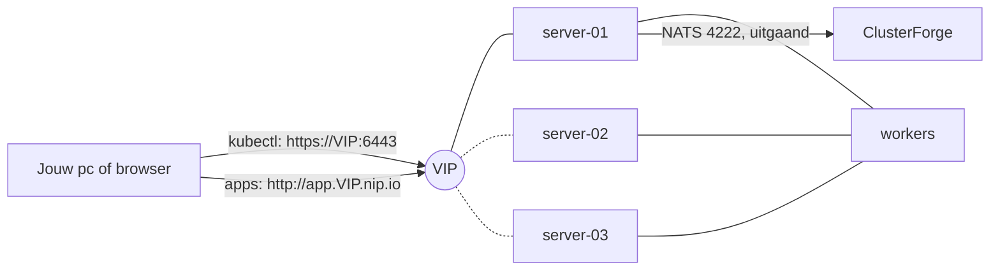

# ClusterForge – Technisch ontwerp fase 4: Kubernetes

Stand: 2026-10-11

## Samenvatting

Jonas wil Kubernetes leren zonder eerst een week te moeten kiezen tussen netwerkplugins, opslag en dashboards. Fase 4 geeft hem dat in ClusterForge zelf. Hij rolt een Kubernetes-cluster uit zoals hij nu een keepalived-cluster uitrolt, en beheert het daarna in dezelfde webinterface: nodes toevoegen en weghalen, apps uitrollen, logs lezen, schalen, upgraden en back-ups maken. Op elk scherm staat wat er gebeurt in gewone woorden, met het `kubectl`-commando dat hetzelfde doet, zodat hij het daarna ook zonder ClusterForge kan.

De stack ligt vast en hij hoeft niets te kiezen: **k3s** op Debian-VM's uit zijn golden image, met keepalived voor één vast adres. Waarom k3s, staat in het volgende hoofdstuk.

| Module | Wat Jonas krijgt | Mijlpalen |
| --- | --- | --- |
| Uitrollen | Een template 'Kubernetes (k3s)': één of drie servers, nul tot tien workers en één VIP voor de API en de apps. Na een paar minuten draait een echt Kubernetes-cluster met netwerk, DNS, ingress, opslag en metrics. | 1 |
| Dashboard | Een pagina Kubernetes met per cluster de nodes, apps, pods, netwerk, opslag, configuratie en gebeurtenissen. Details met YAML en logs, en acties als schalen, herstarten, terugdraaien, een node leegmaken en weghalen. | 2, 3, 4 |
| Apps | Een app uitrollen met een formulier (image, poort, aantal, adres), uit een Helm-chart, of met eigen YAML. Eerst zie je wat er verandert, dan pas past ClusterForge het toe. | 5 |
| Leren | Lessen met opdrachten die ClusterForge op het echte cluster controleert, uitleg bij elk soort object, `kubectl` bij elke actie, en de assistent die uitlegt waarom een pod niet start. | 2 tot 6, 13 |
| Nodes | Een worker of server erbij met één knop (nieuwe VM uit de golden image), een worker netjes weghalen, en onderhoud of een reboot die de node eerst leegmaakt. | 7 |
| Bewaken | Status, incidenten en What Broke voor Kubernetes, CPU en geheugen per node en pod, en een scorekaart Kubernetes in de health score. | 8, 12 |
| Beheer | `kubectl` op je eigen pc met een eigen token, etcd-snapshots, upgrades node voor node, en documentatie. | 9, 10, 11, 12 |

Na mijlpaal 1 heeft Jonas een werkend cluster en kan hij `kubectl` op een server gebruiken. Na mijlpaal 4 beheert hij het helemaal vanuit ClusterForge, na mijlpaal 6 kan hij zichzelf Kubernetes leren met de lessen, en na mijlpaal 7 groeit het cluster met een klik.

**Uitgangspunten**

- **Niets te kiezen.** Eén stack, de standaardonderdelen van k3s, en verstandige standaarden. Wie later iets anders wil (Longhorn, cert-manager, een andere ingress), installeert het als app.
- **Echt Kubernetes.** k3s is een gecertificeerde Kubernetes-distributie. Wat Jonas leert, werkt op elk cluster, en `kubectl` is hetzelfde.
- **Dezelfde regels als de rest van ClusterForge.** Inloggen met TOTP, de rollen admin en viewer, elke actie in het logboek, en op prod de slug en tweestapsverificatie. ClusterForge maakt nog steeds nooit zelf een verbinding naar een node. Alles loopt via de agent.
- **Geheimen blijven op de node.** De beheerderssleutel van het cluster verlaat de server-node nooit, en de waarden van Kubernetes-secrets komen niet in ClusterForge, ook niet bij de assistent.
- **Hergebruik.** Uitrollen, nieuwe VM's, de gewenste staat met drift, de uitrol node voor node met gezondheidscontrole, incidenten, What Broke, de health score, de documentatie, de DR-repetitie en de assistent bestaan al. Kubernetes wordt een clustertype dat daar bij past, geen tweede product ernaast.
- **Eén agentupdate.** Agentprotocol 8 (mijlpaal 2) brengt alles wat de agent voor Kubernetes nodig heeft. Daarna is er geen nieuwe update nodig.

## Waarom k3s

### De keuze

| Kandidaat | Wat het is | Waarom wel of niet |
| --- | --- | --- |
| **k3s** (gekozen) | Kubernetes in één binary, met alles wat een cluster nodig heeft erin. | Installeert in een minuut op gewone Debian-VM's. Netwerk, DNS, ingress, load balancer, opslag en metrics zitten erin, dus er is niets te kiezen. Drie servers met de ingebouwde etcd geven HA. Weinig geheugen nodig. |
| kubeadm | De officiële manier om Kubernetes zelf op te bouwen. | Leerzaam, maar je kiest en onderhoudt alles zelf: container-runtime, netwerkplugin, ingress, load balancer, opslag, metrics. Precies waar eerdere pogingen op vastlopen. |
| RKE2 | De zus van k3s, strenger beveiligd. | Zwaarder en meer voor bedrijven met compliance-eisen. Voor leren en een homelab biedt het niets extra. |
| MicroK8s | Kubernetes als snap-pakket. | Werkt het best op Ubuntu met snap, en addons gaan per stuk aan. Debian zonder snap past beter bij de rest van ClusterForge. |
| Talos | Een eigen besturingssysteem dat alleen Kubernetes draait. | Mooi, maar zonder shell en zonder plek voor cf-agent. ClusterForge zou die nodes niet kunnen zien of beheren. |
| Docker Swarm | Clustering van Docker zelf. | Jonas probeerde het al, en er wordt veel minder voor gebouwd dan voor Kubernetes. Wat hij met Kubernetes leert, is breder bruikbaar. |

### Waarom VM's en geen CT's

Kubernetes heeft kernelmodules, eigen cgroups, iptables-regels, `/dev/kmsg` en overlay-bestandssystemen nodig. In een LXC-container op Proxmox kan dat alleen als privileged container met AppArmor uit en extra instellingen in de config van de CT, en zo'n opstelling breekt geregeld na een Proxmox-update. Dat is waarschijnlijk ook waarom eerdere pogingen moeizaam gingen (afgeleid, niet nagegaan). Een VM heeft die beperkingen niet. Bovendien maakt ClusterForge nieuwe nodes alleen als VM uit de golden image, en dat is precies wat nodes toevoegen met één knop nodig heeft.

Jonas' bestaande CT's met keepalived blijven gewoon zoals ze zijn. Kubernetes komt ernaast, op eigen VM's.

### Wat er in een k3s-cluster zit

Deze tabel staat ook in de webinterface, bij de uitleg van het cluster.

| Onderdeel | Wat het doet |
| --- | --- |
| containerd | Draait de containers op elke node. |
| Flannel | Het netwerk tussen pods op verschillende nodes. |
| CoreDNS | Namen binnen het cluster, zoals `web.demo.svc.cluster.local`. |
| Traefik | De ingress: stuurt een webverzoek op hostnaam naar de juiste app. |
| ServiceLB | Geeft een Service van type LoadBalancer een poort op de nodes. |
| local-path-provisioner | Volumes op de schijf van een node. |
| metrics-server | CPU en geheugen per node en pod (`kubectl top`). |
| Helm-controller | Installeert een Helm-chart uit een object `HelmChart`, zonder Helm op je pc. |
| etcd | De database van het cluster, gerepliceerd over de servers. |

### De vorm van een cluster

- **Servers** draaien de API, de scheduler en etcd. Eén server is genoeg om te leren; drie servers overleven het uitvallen van één. Vijf kan ook. Een even aantal niet, want etcd heeft een meerderheid nodig.
- **Workers** draaien alleen apps. Nul workers mag: dan draaien de apps op de servers.
- **Het VIP** is één vast adres voor het hele cluster. Keepalived zet het op een server waarvan de API antwoordt. `kubectl` praat ermee op poort 6443, en Traefik beantwoordt er de apps op poort 80 en 443. Ook met één server is er een VIP, zodat het adres niet verandert als het cluster later naar drie servers groeit.
- **etcd staat altijd aan**, ook met één server. Dan werken snapshots meteen, en is van één naar drie servers gaan alleen nodes toevoegen.

Standaardvormen in de template:

| Vorm | Nodes | Totaal |
| --- | --- | --- |
| Leren (standaard) | 1 server (2 vCPU, 4 GB, 30 GB) en 2 workers (2 vCPU, 4 GB, 40 GB) | 6 vCPU, 12 GB geheugen, 110 GB schijf |
| HA | 3 servers en 2 workers, zelfde maten | 10 vCPU, 20 GB geheugen, 170 GB schijf |

### Waarom het dashboard in ClusterForge zit

Een losse dashboard-app zoals Headlamp, Rancher of Kubernetes Dashboard heeft een eigen login en eigen rechten, en weet niets van Jonas' Proxmox-hosts, VM's, nodes, logboek of incidenten. In ClusterForge staat een pod naast de node, de VM en de Proxmox-host waarop hij draait, met dezelfde login, rollen en prod-bevestiging. Wie toch Headlamp, Lens of k9s wil, kan die op zijn pc gebruiken met een eigen kubeconfig uit ClusterForge (mijlpaal 9).

## Wat ClusterForge al heeft en wat ontbreekt

Bruikbaar zoals het is:

- **Uitrollen uit een template** met VM's uit de golden image, aanmelden van de agent, de stappen node voor node in de volgorde van de spec, en controles achteraf (`internal/deploy/run.go`).
- **Geheimen in een template**: het type `secret` maakt een waarde aan, bewaart ze versleuteld en toont ze gemaskeerd als `[geheim]`. Dat wordt het jointoken van k3s.
- **De gewenste staat met revisies en drift**, dus een met de hand aangepaste `/etc/rancher/k3s/config.yaml` valt op.
- **De uitrol node voor node** met een gezondheidscontrole na elke node, en nieuwe nodes erbij (`internal/rollout`, `internal/deploy/grow.go`).
- **Keepalived** met VIP-volging, failovertests, de wat-als en de DR-repetitie.
- **Incidenten, What Broke, de health score, de documentatie en de assistent** met hun uitbreidingspunten per clustertype.

Wat ontbreekt:

| Gat | Gevolg | Opgelost in |
| --- | --- | --- |
| Er is geen clustertype `kubernetes` (`internal/inventory/validate.go:16`, `api/openapi.yaml:4902`). | Een k3s-cluster heet 'algemeen' en krijgt geen eigen schermen. | Mijlpaal 1 |
| Elke rol in een template heeft minstens één node (`internal/templates/templates.go:395`). | Een cluster zonder workers kan niet. | Mijlpaal 1: een rol mag `min: 0` hebben |
| Een int-parameter kent alleen een minimum en maximum. | 'Eén, drie of vijf servers' is niet uit te drukken. | Mijlpaal 1: `choices` |
| De controles na een uitrol kennen alleen `vip_owned` en `http` (`internal/deploy/run.go:510`). | Genoeg voor mijlpaal 1: Traefik antwoordt 404 op het VIP als API, scheduler, netwerk en ingress werken. Voor 'alle nodes Ready' is een nieuwe controle nodig. | Mijlpaal 1 (`http` met 404), mijlpaal 2 (`kube_ready`) |
| De agent kan niet met de Kubernetes-API praten, en de server mag zelf geen verbinding met een node maken (README, 'Draaien met Docker Compose'). | Het dashboard heeft geen bron. | Mijlpaal 2: de kube-brug in agentprotocol 8 |
| Een NATS-bericht is hoogstens 1 MiB (`internal/agentbus/bus.go:117`). | Een lijst van alle pods van een groot cluster past er niet in. | Mijlpaal 2: pagineren, `managedFields` weglaten en comprimeren |
| De spec van een cluster verandert alleen via GitOps (`internal/gitops/plan.go:130`); de webinterface toont revisies maar wijzigt ze niet. | 'Node toevoegen' of 'upgraden' met een knop kan niet. | Mijlpaal 7: de spec wijzigen in de webinterface |
| Er is geen omlaag schalen, en alleen de sandbox mag een VM verwijderen (`internal/backups/callers_test.go:19`). | Een worker weghalen kan niet. | Mijlpaal 7: een tweede, smal bewaakte plek die een VM mag verwijderen |
| Onderhoud en reboot verhuizen alleen VIP's (`internal/lifecycle/lifecycle.go:469`). | Een reboot van een worker laat zijn pods hard wegvallen. | Mijlpaal 4: eerst leegmaken in Kubernetes |
| De clusterstatus kijkt naar nodes en VIP's (`internal/status/rules.go:180`). | Een app die crasht, is onzichtbaar. | Mijlpaal 8 |

## Gedeelde bouwstenen

### Template 'Kubernetes (k3s)'

Een nieuwe ingebouwde template `kubernetes`, clustertype `kubernetes`, met twee rollen:

| Rol | Aantal | Wat er op komt |
| --- | --- | --- |
| `server` | 1, 3 of 5 (standaard 1) | k3s als server, keepalived voor het VIP |
| `worker` | 0 tot 10 (standaard 2) | k3s als agent |

Parameters: het VIP (verplicht, vast na de uitrol), het aantal servers en workers, de maten per rol, en het jointoken als `secret` dat ClusterForge zelf maakt. De k3s-versie hoort bij de templateversie: `kubernetes 1.0.0` installeert één vaste k3s-versie (v1.35.9+k3s1). Het installatiescript in de template controleert de SHA-256 met het controlebestand van dezelfde release, zoals het officiële installatiescript van k3s. Een nieuwere k3s is een nieuwe templateversie, en upgraden is overstappen naar die versie (mijlpaal 11).

Stappen per node, in deze volgorde:

1. `curl` en `ca-certificates` installeren.
2. De k3s-binary downloaden van de GitHub-release, de SHA-256 controleren en pas daarna op zijn plek zetten. Het script zet daarna een merkteken met de versie, en de command-stap heeft dat als `creates`. Zo doet de stap niets als de juiste versie er al staat, en ziet ook de driftcontrole het.
3. `/etc/rancher/k3s/config.yaml` (modus 0600): de rol, `node-ip`, het token, `tls-san` met het VIP, en voor de eerste server `cluster-init`. Elke andere node meldt zich aan via `https://VIP:6443`.
4. De systemd-unit `k3s.service` of `k3s-agent.service`, met `modprobe` van `br_netfilter` en `overlay` vooraf, en starten. De unit is van type `notify`, dus de stap wacht tot k3s klaar is.
5. Op servers: keepalived met een controle of de API op die node antwoordt, en `kubectl` als link naar k3s.

De nodes worden in de volgorde van de spec gedaan, dus eerst server-01 (die het cluster begint en het VIP krijgt), dan de andere servers, dan de workers. De controles na de uitrol: het VIP heeft een houder, en `http://VIP/` geeft 404 van Traefik. Die 404 bewijst dat API, scheduler, netwerk, ServiceLB en ingress werken. Vanaf mijlpaal 2 komt er de controle `kube_ready` bij: alle nodes zijn Ready.

### Agentprotocol 8: de kube-brug

De server praat nooit rechtstreeks met de Kubernetes-API. Een verzoek gaat zo:

1. De browser vraagt ClusterForge iets, met de gewone sessie, rol en zo nodig TOTP.
2. ClusterForge stuurt een getypt commando over NATS naar de agent op een server-node van dat cluster die online is.
3. De agent stuurt het door naar `https://127.0.0.1:6443`, met het beheerderscertificaat uit `/etc/rancher/k3s/k3s.yaml`.
4. De agent filtert het antwoord en stuurt het terug.

Zo hoeft er geen poort naar ClusterForge open, verlaat de beheerderssleutel de node nooit, en staat elke schrijvende actie in het logboek. Valt een server weg, dan neemt ClusterForge de volgende.

De commando's:

| Commando | Wat |
| --- | --- |
| `kube.read` | `get` en `list` van elk soort object, ook CRD's, en de discovery-lijst. |
| `kube.logs` | De laatste regels van een container, ook van de vorige als hij herstartte. |
| `kube.apply` | Server-side apply met field manager `clusterforge`, eventueel als dry-run. |
| `kube.patch` | Schalen, herstarten, terugdraaien, cordon en uncordon. |
| `kube.delete` | Een object weghalen. |
| `kube.evict` | Eén pod uitzetten via de Eviction-API, zodat een PodDisruptionBudget geldt. |
| `kube.token` | Een token met vervaldatum voor een ServiceAccount (mijlpaal 9). |
| `kube.snapshot` | etcd-snapshots tonen en maken, en in lab en test terugzetten (mijlpaal 10). |

De agent controleert elk verzoek tegen een vaste lijst. `exec`, `attach`, `portforward` en `proxy` bestaan niet in de brug. Uit elk Secret haalt de agent de waarden voordat het antwoord de node verlaat. ClusterForge ziet alleen de sleutels en hoe lang elke waarde is. `metadata.managedFields` gaat er altijd af. Een lijst komt in pagina's van 250, en een antwoord boven 64 KB gaat gecomprimeerd. Past het dan nog niet, dan zegt de foutmelding om op namespace te filteren.

De agent stuurt ook nieuwe facts: de rol (server of agent), de k3s-versie, de nodenaam in Kubernetes, of de API lokaal antwoordt en of de kubelet gezond is. Een agent op protocol 7 werkt door, maar het dashboard toont dan 'agent te oud', met het commando om bij te werken.

De brug werkt ook voor een k3s-cluster dat Jonas met de hand bouwde. Zet hij cf-agent op een server-node en het clustertype op Kubernetes, dan verschijnt het in het dashboard. Alleen nodes toevoegen en upgraden vragen een cluster uit de template.

### Kube-sync en datamodel

Het dashboard leest live via de brug, met een cache van twee seconden zodat tien open tabbladen niet tien keer vragen. Daarnaast vat een achtergrondtaak elk cluster elke 30 seconden samen, voor status, incidenten, score en documentatie:

| Tabel | Inhoud | Bewaard |
| --- | --- | --- |
| `kube_clusters` | API bereikbaar, versie, aantal nodes en pods, laatste sync en fout | actueel |
| `kube_nodes` | Kubernetes-node met de gekoppelde ClusterForge-node, rollen, Ready, cordon, versie, capaciteit | actueel |
| `kube_workloads` | Deployments, StatefulSets en DaemonSets met gewenst, klaar, images en revisie | actueel |
| `kube_events` | Waarschuwingen en uitrollen uit de Kubernetes-events | 30 dagen |
| `kube_lessons` | Voortgang per gebruiker en les | altijd |
| `kube_access` | Uitgegeven kubeconfigs: wie, rol, vervaldatum, ingetrokken | altijd |

CPU en geheugen per node, namespace en pod komen elke minuut uit metrics-server en gaan naar VictoriaMetrics, met dezelfde labels als de node-metrics plus `namespace` en `pod`.

### Leermodus

De leermodus staat standaard aan en is per gebruiker uit te zetten. Hij voegt drie dingen toe:

- **'Wat is dit?'** bij elk soort object: een korte Nederlandse uitleg van wat een Pod, Deployment, Service, Ingress, ConfigMap, PersistentVolumeClaim of Namespace is, en hoe het samenhangt met wat erboven en eronder staat.
- **'Zo doe je dit met kubectl'** onder elke lijst en elke actie: het exacte commando, om te kopiëren. Schalen naar drie toont `kubectl -n demo scale deployment web --replicas=3`.
- **De keten**: bij een pod staat van welke ReplicaSet en Deployment hij komt, op welke node, VM en Proxmox-host hij draait, en via welke Service en Ingress hij bereikbaar is.

## Het dashboard

Een nieuw menu-item **Kubernetes**, met de lijst van Kubernetes-clusters: versie, nodes Ready, pods, waarschuwingen en status. Per cluster zijn er tabbladen, met bovenaan een keuze van namespace (standaard alles behalve de systeemnamespaces, met een vinkje 'systeem tonen').

| Tabblad | Inhoud |
| --- | --- |
| Overzicht | Versie, API en VIP, nodes, pods per status, CPU en geheugen, de laatste waarschuwingen, en wat er in het cluster zit. |
| Nodes | Kubernetes-nodes naast hun ClusterForge-node en VM, met rol, Ready, cordon, pods en belasting. Node toevoegen, leegmaken, weghalen. |
| Apps | Deployments, StatefulSets, DaemonSets, Jobs en CronJobs, met klaar tegen gewenst en de images. Schalen, herstarten, terugdraaien. |
| Pods | Alle pods met status, herstarts, node en leeftijd. Logs, weghalen. |
| Netwerk | Services en Ingresses, met klikbare adressen. |
| Opslag | PersistentVolumeClaims, volumes en StorageClasses. |
| Configuratie | ConfigMaps, en Secrets met alleen de sleutels. |
| Gebeurtenissen | De events van het cluster, waarschuwingen eerst. |
| Alles | Elk soort object dat de API kent, ook van geïnstalleerde apps (CRD's). |
| Toepassen | YAML plakken of een app uit het formulier: eerst controleren en het verschil zien, dan toepassen. |
| Lessen | De lessen met voortgang (mijlpaal 6). |

Een object openen toont de status in gewone woorden, de condities, de keten, de events van dat object, de YAML (alleen-lezen, zonder secretwaarden) en de acties. Een pod toont ook zijn logs, met een keuze van container, de vorige container, het aantal regels en automatisch verversen. Pagina's verversen zichzelf elke vijf seconden zolang ze open staan.

**Rechten.** Een viewer ziet alles behalve secretwaarden (die ziet niemand) en mag logs lezen, net als de standaardrol `view` van Kubernetes. Alleen een admin voert acties uit. Op prod vraagt elke actie die iets verandert de slug en TOTP, zoals overal in ClusterForge.

**Apps uitrollen (mijlpaal 5).** Drie manieren, die alle drie op dezelfde controle uitkomen:

- **Het formulier 'Nieuwe app'**: naam, image, poort, aantal, omgevingsvariabelen, eventueel een volume en een webadres. ClusterForge maakt er een Deployment, Service en Ingress van, en toont de YAML naast het formulier met per blok wat het doet.
- **Een Helm-chart**: repository, chart, versie en waarden. ClusterForge maakt een object `HelmChart` voor de ingebouwde Helm-controller van k3s.
- **Eigen YAML**: plakken of een voorbeeld kiezen (whoami, nginx, Uptime Kuma, een PostgreSQL als StatefulSet).

Daarna volgt de controle: een server-side dry-run per object, met fouten bij het juiste veld en het verschil met wat er nu draait. Pas na 'Toepassen' verandert er iets. Een conflict met velden die een ander programma beheert (bijvoorbeeld `kubectl`) toont wie ze beheert, en 'Overnemen' forceert alleen na bevestiging.

**Webadressen.** Een app krijgt standaard het adres `<app>.<VIP>.nip.io`. Zo'n naam wijst zonder eigen DNS naar het VIP, waar Traefik hem op hostnaam doorstuurt. Sommige routers en Pi-holes weigeren DNS-antwoorden met een privéadres; dan stelt Jonas een eigen domein in, met een wildcardrecord naar het VIP.

## Nodes, upgrades en back-ups

**Node toevoegen (mijlpaal 7).** Op het tabblad Nodes kiest Jonas 'Worker toevoegen' of 'Server toevoegen'. ClusterForge verhoogt het aantal in de spec en toont het plan: welke VM, welk adres, op welke Proxmox-host. Na bevestiging volgt de bestaande uitrol: de VM uit de golden image, de agent aanmelden, de stappen toepassen, en de node meldt zich aan bij het cluster. Van één naar drie servers gaat in één plan, omdat etcd al draait.

Hiervoor komt er een algemene bouwsteen: **de spec wijzigen in de webinterface** voor clusters uit een template, met hetzelfde plan, dezelfde revisies en dezelfde uitrol als GitOps. Een cluster dat Git volgt, weigert dat met de melding dat `cluster.yaml` de bron is.

**Worker weghalen (mijlpaal 7).** Een taak in vaste stappen: cordon, de pods uitzetten met de Eviction-API (een PodDisruptionBudget geldt), de node uit Kubernetes verwijderen, k3s stoppen, de VM stoppen en verwijderen in Proxmox, de node uit ClusterForge halen, en een nieuwe specrevisie met één worker minder. Een server weghalen kan in deze fase niet, omdat etcd zijn meerderheid moet houden. Het verwijderen van een VM is nu alleen voor de sandbox toegestaan. Er komt één tweede plek bij, met een eigen test die controleert dat ze alleen een geleegde worker van een Kubernetes-cluster verwijdert.

**Onderhoud en reboot (mijlpaal 4).** Gaat een node van een Kubernetes-cluster in onderhoud of reboot, dan maakt ClusterForge hem eerst leeg in Kubernetes (cordon en uitzetten), en na de reboot weer beschikbaar zodra hij Ready is.

**Upgraden (mijlpaal 11).** Een nieuwere templateversie met een nieuwere k3s staat als 'Bijwerken naar k3s v…' op het overzicht. Het plan gaat node voor node, eerst de servers, dan de workers. Per node: leegmaken, de nieuwe binary, herstarten, wachten tot de node Ready is met de nieuwe versie en de API via het VIP antwoordt, weer beschikbaar maken. Bij de eerste fout stopt het plan. Kubernetes staat maar één minorversie per keer toe, dus ClusterForge biedt alleen de volgende aan.

**etcd-snapshots (mijlpaal 10).** k3s maakt standaard elke twaalf uur een snapshot op elke server en houdt er vijf. Het dashboard toont ze, met 'Snapshot nu'. Een snapshot ouder dan een dag wordt een bevinding in de score. Terugzetten is een geleide taak in lab en test. Voor prod staat het als runbook in de documentatie, met de commando's. De Proxmox-back-ups van de VM's blijven de eerste lijn, en de DR-repetitie van fase 3 werkt ook voor een Kubernetes-cluster: de bestaande controle op het VIP krijgt de 404 van Traefik.

## Status, incidenten en score

- **Clusterstatus (mijlpaal 8).** Down als de API via geen enkele server antwoordt. Verminderd als een node NotReady is, een etcd-lid ontbreekt, of een app in een eigen namespace al twee minuten minder pods klaar heeft dan gewenst. Anders gezond. Elke app krijgt zo een eigen status, en een overgang wordt een incident zoals bij een dienst.
- **What Broke (mijlpaal 8).** De tijdlijn krijgt de Kubernetes-events erbij. Een uitrol met een nieuwe image is een verandering, en `BackOff`, `OOMKilled`, `FailedScheduling` en `Unhealthy` zijn symptomen. Een regel kan dus luiden: 'web in demo crasht sinds de uitrol van image nginx:1.29 om 14:02'.
- **Scorekaart Kubernetes (mijlpaal 12).** Bevindingen zoals:
  - één server zonder HA op prod;
  - een snapshot ouder dan een dag;
  - een node NotReady;
  - pods die blijven herstarten;
  - een app op prod met één pod;
  - images met `:latest`;
  - pods zonder geheugenlimiet;
  - een k3s-versie die geen updates meer krijgt.
- **Documentatie (mijlpaal 12).** Een hoofdstuk Kubernetes per cluster: versie, nodes, namespaces, apps met images en aantallen, webadressen, opslag, snapshots, en runbooks voor een node vervangen, upgraden en etcd terugzetten.

## kubectl op je eigen pc

Mijlpaal 9 geeft elke gebruiker een eigen kubeconfig. ClusterForge maakt per gebruiker een ServiceAccount in de namespace `clusterforge`, met de rol `cluster-admin` voor een admin of `view` voor een viewer. Via `kube.token` vraagt het een token met een vervaldatum, standaard zeven dagen en hoogstens dertig. De kubeconfig wijst naar `https://VIP:6443` met het CA-certificaat van het cluster. 'Intrekken' verwijdert het ServiceAccount, en dan werkt het token meteen niet meer. Elke uitgifte staat in het logboek, en een admin-kubeconfig voor prod vraagt TOTP. Met dezelfde kubeconfig werken k9s, Headlamp en Lens.

## De lessen

Mijlpaal 6 voegt een tabblad Lessen toe. Elke les heeft een paar opdrachten, en ClusterForge controleert op het echte cluster of een opdracht gelukt is, alleen lezend. Elke opdracht kan via de webinterface of met `kubectl`; beide staan erbij. Een les werkt in de namespace `leren`, en 'Opruimen' haalt die weg.

1. **Je cluster verkennen**: nodes, namespaces en de systeempods, en wat elk onderdeel doet.
2. **Je eerste app**: een Deployment met nginx, en kijken hoe de pod ontstaat.
3. **Schalen en zelfherstel**: naar drie pods, één weghalen en zien dat hij terugkomt, en op welke nodes ze staan.
4. **Bereikbaar maken**: een Service en een Ingress, en de app openen in de browser.
5. **Een nieuwe versie**: een nieuwe image uitrollen, de uitrol volgen en terugdraaien.
6. **Configuratie en geheimen**: een ConfigMap en een Secret als omgevingsvariabelen.
7. **Opslag die blijft**: een volume met local-path, de pod herstarten en zien dat de data er nog is, en waarom de pod nu aan die node vastzit.
8. **Een node in onderhoud**: cordon en leegmaken, zien waar de pods heen gaan, en terugzetten.
9. **Een node erbij** (vanaf mijlpaal 7): een worker toevoegen en pods erheen zien gaan.
10. **Een server valt uit** (alleen lab, met drie servers): een server-VM hard stoppen en zien dat de API via het VIP blijft antwoorden.

Vanaf mijlpaal 13 heeft elke opdracht een knop 'Ik zit vast', waarmee de assistent kijkt wat er op het cluster staat en een hint geeft zonder het antwoord voor te zeggen.

## De assistent

Mijlpaal 13 geeft de assistent tools voor Kubernetes, die net als de rest alleen lezen: het overzicht van een cluster, een object met zijn events en keten, en de laatste 200 logregels van een pod. Die logregels gaan door hetzelfde filter als staplogs, dat tokens en wachtwoorden maskeert. Er komt 'Leg uit' bij elk object en elke waarschuwing, bijvoorbeeld 'Waarom start deze pod niet?'. Secretwaarden komen nooit bij de assistent, want ClusterForge heeft ze zelf niet.

## Veiligheid

- **De beheerderssleutel blijft op de node.** De agent leest `/etc/rancher/k3s/k3s.yaml` lokaal. ClusterForge bewaart geen kubeconfig met beheerdersrechten.
- **Een vaste lijst in de agent.** Alleen de commando's hierboven, met gecontroleerde paden. Geen `exec`, `attach`, `portforward` of `proxy`. Een fout in de server kan de agent dus ook niet laten doen wat hij niet kent.
- **Geen secretwaarden.** De agent haalt ze weg voordat een antwoord de node verlaat. Een Secret maken met het formulier of met YAML stuurt de waarde één keer door naar de agent. Ze komt niet in de database, en het logboek toont alleen de sleutels.
- **YAML toepassen is beheerdersmacht.** Wie YAML mag toepassen, kan via een privileged pod de nodes overnemen. Daarom mag alleen een admin het, en op prod alleen met de slug en TOTP.
- **Het jointoken** is een `secret`-parameter, versleuteld bewaard, gemaskeerd in previews en drift, en alleen in het bestand met modus 0600 op de node.
- **Uitgaand verkeer van de nodes**: GitHub voor de k3s-binary (met SHA-256-controle) en de registries voor images. ClusterForge zelf maakt geen nieuwe uitgaande verbinding.

## Testen zonder echt cluster

In de bouwomgeving draait geen echte Kubernetes. Daarom komt er een nep-API, `internal/kube/kubefake`, net als `pvefake` voor Proxmox en `ghfake` voor GitHub. Hij kent discovery, `get` en `list`, server-side apply, patch, delete, eviction met PodDisruptionBudgets, logs en TokenRequest. De tests draaien de echte agent tegen kubefake met TLS-certificaten. De template wordt getest op de gerenderde bestanden, en `hack/` krijgt een nagespeeld k3s-cluster voor de schermafbeeldingen.

De eerste echte uitrol gebeurt dus op Jonas' Proxmox. Daarom begint hij het best met een lab-cluster in de vorm Leren.

## Bouwvolgorde

| # | Mijlpaal | Klaar als | Grootte |
| --- | --- | --- | --- |
| 1 | Template Kubernetes (k3s) | Uitrollen met de vorm Leren geeft drie VM's, k3s draait, het VIP staat op server-01 en `http://VIP/` geeft 404 van Traefik. `sudo kubectl get nodes` op de server toont drie nodes Ready. Het token staat nergens leesbaar. | M |
| 2 | Kube-brug en overzicht | Agentprotocol 8. Het menu Kubernetes toont het cluster met versie, nodes (gekoppeld aan de ClusterForge-nodes), apps en pods. Een met de hand gebouwd k3s-cluster verschijnt ook. Een test bevestigt dat geen secretwaarde de agent verlaat en dat `exec` niet bestaat. | L |
| 3 | Details, logs en gebeurtenissen | Een pod openen toont status, keten, events, YAML en logs, ook van de vorige container. Netwerk, Opslag, Configuratie, Gebeurtenissen en Alles werken, met 'Wat is dit?' en `kubectl` erbij. | M |
| 4 | Acties | Schalen, herstarten, terugdraaien, weghalen, cordon, uncordon en leegmaken staan in het logboek. Op prod vragen ze slug en TOTP. Een reboot van een worker maakt hem eerst leeg en daarna weer beschikbaar. | M |
| 5 | Apps uitrollen | Het formulier met whoami geeft Deployment, Service en Ingress, en na Toepassen opent `http://whoami.VIP.nip.io`. Een Helm-chart installeert via `HelmChart`. Foute YAML geeft de fout bij het veld, en een tweede keer toepassen geeft 'geen verschil'. | L |
| 6 | Lessen | Les 1 tot en met 8 zijn te volgen, de voortgang blijft bewaard, en elke opdracht wordt gecontroleerd op het cluster. Opruimen haalt `leren` weg. | M |
| 7 | Nodes toevoegen en weghalen | 'Worker toevoegen' maakt een VM, en de node is binnen een paar minuten Ready. Van één naar drie servers lukt in één plan. 'Worker weghalen' maakt hem leeg en verwijdert node en VM. Een server weghalen wordt geweigerd. De spec is in de webinterface te wijzigen voor clusters zonder Git. | L |
| 8 | Status, incidenten en metrics | Een app met een kapotte image maakt het cluster verminderd, geeft een incident, en What Broke noemt de uitrol als oorzaak. CPU en geheugen per pod staan in een grafiek. | L |
| 9 | kubectl op je eigen pc | Een kubeconfig downloaden werkt met kubectl en k9s. Een viewer kan niets wijzigen, en na Intrekken weigert het cluster het token. | S |
| 10 | etcd-snapshots | Snapshots per server staan in het dashboard en bij Back-ups. 'Snapshot nu' werkt, en terugzetten werkt in lab. Op prod staat het runbook. | M |
| 11 | Upgraden | Een cluster op `kubernetes 1.0.0` gaat naar 1.1.0, node voor node met leegmaken, en stopt bij de eerste node die niet terugkomt. | M |
| 12 | Score en documentatie | De scorekaart Kubernetes met de bevindingen hierboven, en het hoofdstuk Kubernetes in de documentatie met de runbooks. | M |
| 13 | Assistent voor Kubernetes | 'Waarom start deze pod niet?' geeft de reden uit de events en logs. 'Ik zit vast' in een les geeft een hint. Een test bevestigt dat geen tool schrijft of een secret teruggeeft. | M |

**Waarom deze volgorde.** Eerst een cluster, zodat Jonas meteen iets heeft om mee te spelen, desnoods met `kubectl` op de server. Daarna lezen, dan doen, dan apps uitrollen. Dat is ook de volgorde waarin je Kubernetes leert, en de lessen komen zodra alles erin staat wat ze nodig hebben. Nodes toevoegen komt daarna, omdat het de spec in de webinterface nodig heeft, wat een algemene uitbreiding is. Bewaken, toegang op de pc, back-ups en upgrades volgen als het cluster echt gebruikt wordt. Valt het einde buiten de tijd, dan blijft alle eerdere waarde staan.

## Open keuzes

Elke keuze is ingevuld met een aanbeveling, en het ontwerp volgt overal de aanbevolen kolom.

| Keuze | Aanbevolen | Alternatief | Waarom |
| --- | --- | --- | --- |
| Welke Kubernetes? | k3s | kubeadm, RKE2, MicroK8s, Talos | Zie 'Waarom k3s': niets te kiezen, licht, gecertificeerd, HA met de ingebouwde etcd. |
| VM of CT? | VM uit de golden image | Privileged LXC | Kubernetes in LXC vraagt onveilige instellingen en breekt geregeld. Nodes toevoegen kan alleen met VM's. |
| Hoe komt ClusterForge bij de API? | Via de agent op een server-node | Een kubeconfig op de server en zelf verbinden met `VIP:6443` | ClusterForge maakt nooit zelf verbinding met een node, en een beheerderssleutel op de server is een groot doelwit. |
| Eigen dashboard of een bestaand? | In ClusterForge | Headlamp, Rancher of Kubernetes Dashboard | Eén login, rollen, logboek en prod-bevestiging, en de koppeling met nodes, VM's en Proxmox. Headlamp en k9s kunnen ernaast met een eigen kubeconfig. |
| Vast adres voor de API? | Keepalived, dat Jonas al kent | kube-vip | Keepalived zit al in ClusterForge, met VIP-volging, failovertests en de wat-als. |
| etcd met één server? | Altijd aan | SQLite, de standaard van k3s bij één server | Snapshots werken meteen, en groeien naar drie servers is alleen nodes toevoegen. |
| Ingress en load balancer? | Traefik en ServiceLB uit k3s | Een eigen keuze installeren | Werkt meteen, en het VIP is ook het adres van de apps. |
| Opslag? | local-path uit k3s | Longhorn, NFS of Ceph | Genoeg om te leren. Een volume zit aan één node vast, en dat is meteen een les. Longhorn kan later als app. |
| Hoe krijgt Jonas `kubectl` op zijn pc? | Een ServiceAccount per gebruiker met een token dat verloopt | Een clientcertificaat per gebruiker | Een certificaat is in Kubernetes niet in te trekken. Een ServiceAccount verwijderen wel, en dan werkt het token meteen niet meer. |
| Waar hoort de k3s-versie bij? | Bij de templateversie | Een vrije parameter | Eén geteste versie per templateversie, en upgraden is de bestaande overstap naar een nieuwere templateversie. |

## Vragen aan Jonas

Zolang een antwoord ontbreekt, bouwen we met de standaard eronder.

- [ ] Met welke vorm begin je? (mijlpaal 1)

  Standaard zolang je niet antwoordt: Leren, één server en twee workers in lab. Van één naar drie servers gaan kan later met een klik (mijlpaal 7).

- [ ] Welk vrij IP-adres wordt het VIP? (mijlpaal 1)

  Standaard zolang je niet antwoordt: geen. Je vult het in bij Uitrollen. Het moet vrij zijn en in hetzelfde netwerk liggen als de nodes.

- [ ] Hebben de nodes internet, voor GitHub en de container-registries? (mijlpaal 1)

  Standaard zolang je niet antwoordt: ja. Zonder internet start k3s niet en komen er geen images binnen.

- [ ] Mogen we de agents bijwerken naar protocol 8? (mijlpaal 2)

  Standaard zolang je niet antwoordt: ja, met `install.sh --upgrade` per node zoals de webinterface toont, en daarna de golden image opnieuw bouwen. Oudere agents blijven werken, maar zonder het dashboard.

- [ ] Welk domein voor de webadressen van je apps? (mijlpaal 5)

  Standaard zolang je niet antwoordt: `<app>.<VIP>.nip.io`, dat zonder eigen DNS werkt. Weigert je router of Pi-hole dat, dan stel je een eigen domein in met een wildcardrecord naar het VIP.

- [ ] Mogen viewers podlogs lezen? (mijlpaal 3)

  Standaard zolang je niet antwoordt: ja, net als de standaardrol `view` van Kubernetes. Secretwaarden ziet niemand.

## Buiten fase 4

**Bewust niet.**

- Een terminal in een pod (`exec`) en port-forward vanuit de webinterface. De brug kent ze niet. Met je eigen kubeconfig kan het wel.
- Kubernetes in LXC-containers, en andere distributies dan k3s voor uitrollen, nodes toevoegen en upgraden. Lezen en acties werken op elk cluster waar de agent bij een kubeconfig kan.
- Een server weghalen. etcd moet zijn meerderheid houden, en dat vraagt meer stappen dan deze fase biedt.

**Latere uitbreidingen.** Deze punten passen in het ontwerp, maar hebben nog geen mijlpaal:

- apps uit Git: manifesten in de GitOps-repository, met plan, diff en goedkeuren zoals bij clusters;
- certificaten van Let's Encrypt met cert-manager, en gedeelde opslag met Longhorn of NFS, als knop in plaats van als zelf te installeren app;
- namespaces per gebruiker met eigen rechten;
- automatisch nodes bijmaken als het cluster vol raakt;
- NetworkPolicies in de webinterface.
